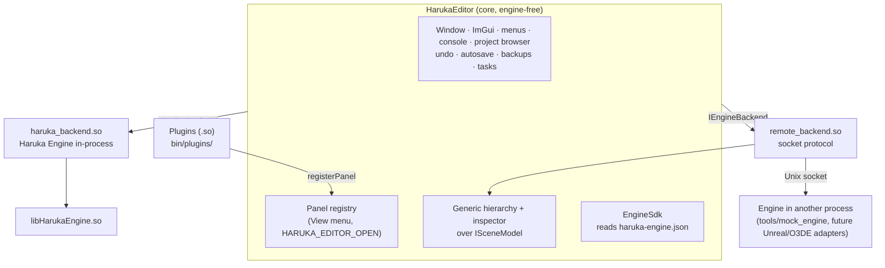

# Haruka Editor

An editor (IDE) for game engines. Its core knows nothing about any particular engine: an engine
plugs in as a **backend**, and features plug in as **panels** and **plugins**. It ships with a
backend for **[Haruka Engine](https://github.com/Andonigt04/haruka-cpp)**, loaded as a shared
library. A second backend drives an engine running in **another process** over a socket; it is
the template for Unreal or O3DE adapters.

> **Status: active development.** What is and is not verified is listed under
> [Status](#status).

---

## Architecture



### The pieces

| Piece | Where | What it is |
|---|---|---|
| **Core** | `src/`, `src/panels/`, `src/commands/`, `src/tasks/` | Window, ImGui, menus, console, project browser, undo/redo, autosave, backups, long-running tasks. It **includes no engine header**; the `check_core_engine_free` target verifies this on every build |
| **Backend contract** | `src/backend/engine_backend.h` | `IEngineBackend`, everything the core knows about an engine: open/save documents, viewport, play mode, its panels. A C++ ABI, versioned |
| **Generic scene** | `src/backend/scene_model.h` | `ISceneModel`, an engine's scene as nodes with typed properties, so the core can draw a hierarchy and inspector for an engine it does not know. It may be asynchronous |
| **Haruka backend** | `src/backends/haruka/` → `bin/backends/haruka_backend.so` | Haruka Engine in-process, with its own panels (scene hierarchy, materials, prefabs, export, stats, viewport) |
| **Remote backend** | `src/backends/remote/` → `remote_backend.so` | Talks to an engine in another process over a Unix socket: a length-prefixed JSON frame, then optional raw binary (for example viewport pixels) |
| **Mock engine** | `tools/mock_engine/` | A simulated engine that implements the whole remote protocol, so the editor can be tested without any engine installed |
| **Plugins** | `src/plugins/haruka_editor_plugin.h`, `plugins/example_panel/` | A `.so` exporting C symbols. In `init` it registers panels with `host->registerPanel` |
| **Engine SDK** | `src/engine_sdk.h` | Finds an engine at runtime through its `haruka-engine.json` descriptor, so an installed editor does not depend on paths from the build machine |

### One ImGui for everyone

The editor executable exports its symbols (`ENABLE_EXPORTS`). The engine, the backend and the
plugins all use **the editor's** Dear ImGui, so there is a single ImGui context. The vendored ImGui
must therefore match the engine's exactly (version and `imconfig.h`). The editor compares versions
and struct sizes when it loads a backend, and **refuses** a mismatched one instead of corrupting
memory. See `third_party/VENDORED.md`.

---

## Building

You need the engine's toolchain if you build the Haruka backend; see
[Building](https://github.com/Andonigt04/haruka-cpp#building) (GCC 16+, CMake 3.25+, SDL3). The
core alone compiles as C++17.

```bash
./build.sh                  # development build; uses ../haruka-cpp if present, otherwise GitHub
./build.sh MODULES=...      # engine module mask
./build.sh release          # portable layout in dist/
./build.sh rpm              # installable package in packages/ (see docs/PACKAGING.md)
./build.sh remote           # force the engine from GitHub
./build.sh ENGINE=/path     # use a specific local engine
```

CMake options:

| Option | Default | Effect |
|---|---|---|
| `HARUKA_EDITOR_BACKEND_HARUKA` | `ON` | Build the Haruka backend (brings in the engine). `OFF` builds the editor without any engine |
| `HARUKA_EDITOR_BACKEND_REMOTE` | `ON` | Build the remote backend and the mock engine |
| `HARUKA_EDITOR_EXAMPLE_PLUGIN` | `ON` | Build `plugins/example_panel` |

### Runtime switches

| Variable | Effect |
|---|---|
| `HARUKA_EDITOR_BACKEND=<path.so>` | Load this backend first |
| `HARUKA_EDITOR_NO_BACKEND=1` | Start without a backend |
| `HARUKA_EDITOR_PLUGINS=<dir:dir>` | Plugin directories searched before the defaults (`bin/plugins/`, `~/.local/share/haruka-editor/plugins/`, the engine's) |
| `HARUKA_EDITOR_PROJECT=<dir>` | Open this project and its default document at startup |
| `HARUKA_EDITOR_OPEN=<panel,...>` | Open these panels at startup (by registry key) |
| `HARUKA_EDITOR_QUIT_AFTER=<seconds>` | Quit after N seconds (for automated runs) |

Running without a window, for example in automated checks:

```bash
SDL_VIDEODRIVER=offscreen HARUKA_EDITOR_QUIT_AFTER=6 XDG_CONFIG_HOME="$(mktemp -d)" ./build/bin/HarukaEditor
```

The resulting `imgui.ini` shows which windows were drawn.

---

## Writing a plugin

```cpp
#include "haruka_editor_plugin.h"
#include "imgui.h"

HARUKA_EDITOR_PLUGIN_DECLARE_API();   // use the macro: a plain const int would not be exported

HARUKA_EDITOR_PLUGIN_EXPORT int haruka_editor_plugin_init(const HarukaEditorHost* host) {
    // host->registerPanel(...): the panel appears in the View menu
    return 1;   // 0 rejects the load
}
```

`plugins/example_panel/` is a complete example. A plugin built against a different contract
version is refused at load time.

---

## Status

Verified:

- The core links no engine (`ldd` shows no `libHarukaEngine`), and `check_core_engine_free` runs
  on every build.
- Panels opened by engine code appear in the host's `imgui.ini`, so the shared ImGui context works.
- The remote client against the real engine ran clean 10/10 under AddressSanitizer and 3/3 under
  ThreadSanitizer.

Not verified yet:

- Unreal and O3DE adapters do not exist. The remote protocol is the base for them.
- Mouse interaction with the generic inspector (it has only been seen drawing).
- The `rpm` package with the current layout.
- The frame rate is uncapped when running offscreen without vsync.

---

## Documentation

| Document | Content |
|---|---|
| [docs/PACKAGING.md](docs/PACKAGING.md) | Building and installing the `.rpm`; install layout (Spanish) |
| [third_party/VENDORED.md](third_party/VENDORED.md) | Vendored dependencies and the ImGui rule (Spanish) |

## Contributing

Read [CONTRIBUTING.md](CONTRIBUTING.md) (DCO sign-off) and [QUALITY.md](QUALITY.md). Report
security problems privately as described in [SECURITY.md](SECURITY.md). Everyone follows the
[Code of Conduct](CODE_OF_CONDUCT.md).

## License

Licensed under the [Apache License 2.0](LICENSE). Use, modification and redistribution are
allowed, commercially or not, and forks are welcome. Any redistribution must keep the
[NOTICE](NOTICE) file (section 4(d)). The license does not grant use of the name "Haruka"
(section 6), so please give your fork its own name. Third-party components keep their own
licenses.
